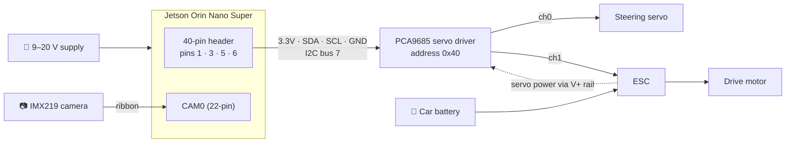
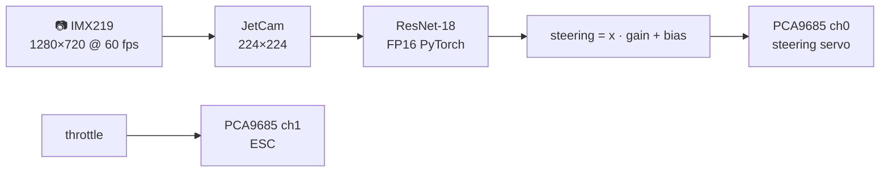

<div align="center">

# 🏎️ JetRacer on JetPack 7

**Build guide for NVIDIA's JetRacer (Tamiya TT-02) on the Jetson Orin Nano Super with JetPack 7**

[](https://developer.nvidia.com/embedded/jetpack)
[](https://developer.nvidia.com/embedded/jetson-orin)
[](https://developer.nvidia.com/cuda-toolkit)
[](https://ubuntu.com)
[](https://www.python.org)
[](https://pytorch.org)
[](#-status)

[Hardware](#3-hardware-and-wiring) · [Manual control](#5-manual-control-jetson--servo-driver-channels-0-and-1) · [Camera](#6-camera) · [AI software](#7-ai-software-cuda-tensorrt-pytorch-opencv-jetcam) · [Training](#9-training-example-a-simple-right-turn) · [Troubleshooting](#11-troubleshooting) · [Checklist](#12-per-car-checklist)

</div>

---

The original [**NVIDIA-AI-IOT/jetracer**](https://github.com/NVIDIA-AI-IOT/jetracer) project was written for the original Jetson Nano on **JetPack 4.x**, with a pre-built "JetCard" SD image. None of that works on JetPack 7. This repo records exactly what it took to get the car working on current hardware and software, so every following car can be built the same way.

> [!CAUTION]
> Don't follow the original [software_setup.md](https://github.com/NVIDIA-AI-IOT/jetracer/blob/master/docs/software_setup.md) on JetPack 7. Use this guide instead. The original [hardware guide](https://github.com/NVIDIA-AI-IOT/jetracer/blob/master/docs/tamiya/hardware_setup.md) is still useful for the chassis build.

## 📊 Status

| Area | Status | Notes |
|---|:---:|---|
| Steering and throttle from the Jetson | ✅ | PCA9685 ch0 → steering servo, ch1 → ESC |
| CSI camera (IMX219) | ✅ | 60 FPS through JetCam |
| PyTorch on the GPU | ✅ | ResNet-18 FP16 at **104 FPS** |
| Camera → model → steering loop | ✅ | **61 Hz** |
| Jupyter notebooks (JetPack 7 patched) | ✅ | Data collection, training, driving |
| RC override (Pololu multiplexer) | ⚠️ | Bypassed on car #1, see [3.3](#33-rc-receiver-and-multiplexer-optional-bypassed-on-car-1) |
| Battery power for the Jetson | ⏳ | Not yet tested |
| Wireless SSH/Jupyter | ⏳ | Not yet set up, see [section 10](#10-wireless-access) |

## 🧭 Setup roadmap


## 📁 Repository contents

| File | Purpose |
|---|---|
| [`README.md`](README.md) | This guide |
| [`scripts/jetracer_jp7_patch.py`](scripts/jetracer_jp7_patch.py) | Patches a fresh clone of the original jetracer repo for JetPack 7 (safe to run more than once) |
| [`scripts/manual_control_test.py`](scripts/manual_control_test.py) | Steering and throttle tests on PCA9685 channels 0 and 1 |

## Contents

1. [Tested configuration](#1-tested-configuration)
2. [What's different from the original repo](#2-whats-different-from-the-original-repo)
3. [Hardware and wiring](#3-hardware-and-wiring)
4. [First connection to the Jetson](#4-first-connection-to-the-jetson)
5. [Manual control: Jetson → servo driver channels 0 and 1](#5-manual-control-jetson--servo-driver-channels-0-and-1)
6. [Camera](#6-camera)
7. [AI software: CUDA, TensorRT, PyTorch, OpenCV, JetCam](#7-ai-software-cuda-tensorrt-pytorch-opencv-jetcam)
8. [Jupyter Lab and the notebooks](#8-jupyter-lab-and-the-notebooks)
9. [Training example: a simple right turn](#9-training-example-a-simple-right-turn)
10. [Wireless access](#10-wireless-access)
11. [Troubleshooting](#11-troubleshooting)
12. [Per-car checklist](#12-per-car-checklist)
13. [References and credits](#13-references-and-credits)

---

## 1. Tested configuration

| Item | Car #1 (October 2026) |
|---|---|
| **Jetson** | Orin Nano Engineering Reference Developer Kit **Super** |
| **JetPack** | **7.2.1** (L4T R39.2.1), Ubuntu 24.04, kernel 6.8 |
| **Python** | 3.12 |
| **CUDA / TensorRT** | 13.2 / 10.16 (`nvidia-jetpack` apt package) |
| **PyTorch / torchvision** | 2.14.1+cu132 / 0.29.1+cu132 |
| **OpenCV** | 4.6 (Ubuntu `python3-opencv`, GStreamer enabled) |
| **Servo driver** | PCA9685 16-channel (HW-170, Adafruit clone) at I2C `0x40` |
| **Camera** | IMX219 CSI on **CAM0** |
| **RC receiver** | FlySky **FS-A3** (AFHDS 2A), not the Futaba 3PV from the original BOM |
| **Chassis** | Tamiya TT-02 |

> [!NOTE]
> The Jetson came already flashed with JetPack 7.2.1. To check yours, run `cat /etc/nv_tegra_release`. It should show `R39 (release), REVISION: 2.1`.

## 2. What's different from the original repo

| | Original (JetPack 4.x, Jetson Nano) | ➜ | JetPack 7 (Orin Nano), this guide |
|---|---|:---:|---|
| 💿 | Flash the pre-built JetCard SD image | ➜ | Not available. Install everything manually (sections 5–8). |
| 🐍 | `sudo python3 setup.py install` | ➜ | Ubuntu 24.04 blocks this. Use a virtual environment (`~/jr`) and `pip install -e`. |
| 🔌 | Servo driver on I2C bus 1 | ➜ | Header pins 3/5 are **I2C bus 7**. The Adafruit library picks this automatically. |
| 📷 | 15-pin camera ribbon | ➜ | **22-pin** camera connectors (use a 15-to-22-pin cable). Enable the camera with `jetson-io`. |
| 🎞️ | `CSICamera(..., capture_fps=65)` | ➜ | `capture_width=1280, capture_height=720, capture_fps=60` |
| ⚡ | torch2trt (TensorRT conversion) | ➜ | **Not used.** It doesn't support TensorRT 10. The FP16 PyTorch model runs at 104 FPS, faster than the camera. |
| 🔥 | PyTorch from NVIDIA's JetPack 4 wheels | ➜ | Standard PyTorch builds for CUDA 13.2 (`download.pytorch.org/whl/cu132`) |
| 🖱️ | `jupyter_clickable_image_widget` | ➜ | Doesn't work with JupyterLab 4. Replaced with `ipyevents`. |
| 🧠 | `torchvision ... (pretrained=True)` | ➜ | `weights='DEFAULT'` |
| 🔋 | 5V USB power bank + J48 jumper | ➜ | Orin Nano needs **9–20V** at the barrel jack |
| ⚙️ | `sudo nvpmodel -m1` (5W on the Nano) | ➜ | Mode numbers mean something different on the Orin. Don't copy this command. |
| 🎮 | Pololu RC multiplexer in the signal path | ➜ | Never switched to the Jetson on car #1, so it was **bypassed** |
| 🐞 | `NvidiaRacecar()` sends nothing at startup | ➜ | Patched to send centre steering and neutral throttle |
| 🛑 | Stopping the drive loop leaves the throttle on | ➜ | Patched to stop the car (there's no RC override) |

## 3. Hardware and wiring

Build the chassis, mounts and camera as in the [original hardware guide](https://github.com/NVIDIA-AI-IOT/jetracer/blob/master/docs/tamiya/hardware_setup.md), with the Orin Nano changes below.



### 3.1 Jetson → servo driver (PCA9685)

Four female-to-female jumper wires. The Orin Nano's 40-pin header has the same layout as the Nano's.

| Jetson 40-pin header | PCA9685 pin | Purpose |
|---|---|---|
| **Pin 1** (3.3V) | `VCC` | Power for the PCA9685 chip |
| **Pin 3** (I2C SDA, bus 7) | `SDA` | Data |
| **Pin 5** (I2C SCL, bus 7) | `SCL` | Clock |
| **Pin 6** (GND) | `GND` | Ground |

> [!IMPORTANT]
> Leave the PCA9685's **OE** and **V+** header pins and the green **V+ screw terminal** unconnected.

### 3.2 Servo driver → car

| PCA9685 channel | Connect to | Code |
|:---:|---|---|
| **0** | Steering servo | `car.steering` |
| **1** | ESC (throttle) | `car.throttle` |

Each 3-pin connector goes on one column of the PCA9685 header:

| Wire colour | PCA9685 row |
|---|---|
| ⚪🟡🟠 White / yellow / orange (signal) | **PWM** (yellow pins) |
| 🔴 Red (+) | **V+** (red pins) |
| ⚫🟤 Black / brown (−) | **GND** (black pins) |

The ESC's red wire powers the steering servo through the PCA9685's shared V+ rail, so **the ESC must be switched on** for the servo to move.

### 3.3 RC receiver and multiplexer (optional, bypassed on car #1)

<details>
<summary><b>Original multiplexer design and what happened on car #1</b> (click to expand)</summary>

<br/>

The original design puts a [Pololu 4-channel RC servo multiplexer](https://www.pololu.com/product/2806) between the RC receiver, the PCA9685 and the car, so a person can take over with the transmitter:

```
Receiver CH1 → MUX M1 ┐
                      ├─ MUX → OUT1 → steering servo
PCA9685 ch0  → MUX S1 ┘

Receiver CH2 → MUX M2 ┐
                      ├─ MUX → OUT2 → ESC
PCA9685 ch1  → MUX S2 ┘

Receiver CH3 → MUX SEL   (above ~1700 µs = Jetson in control)
```

What happened on car #1:

- **Receiver light blinking red:** the receiver wasn't linked to a transmitter. The multiplexer light then blinks too (no valid SEL signal), and the Jetson never gets control.
- **Multiplexer never switched:** even with a working transmitter, and even with SEL driven at 2000 µs from PCA9685 channel 2, the multiplexer kept passing the receiver's signals. The cause wasn't found.
- **Fix:** plug the steering servo and ESC **directly into PCA9685 channels 0 and 1** ([3.2](#32-servo-driver--car)) and leave the multiplexer and receiver out. This worked right away.

</details>

> [!WARNING]
> **Without the multiplexer there's no RC override.** Test with the wheels off the ground and keep your hand near the ESC switch. The patched notebooks always stop the car when you interrupt them.

### 3.4 Camera

- IMX219 camera into **CAM0** on the Orin Nano carrier board, using a **22-pin** ribbon (or a 15-to-22-pin adapter cable).
- Insert the ribbon with the **Jetson powered off**. Plugging it in while running caused "camera not found" errors on car #1.

### 3.5 Power

- The Orin Nano dev kit needs **9–20V** at the DC barrel jack (the stock adapter is 19V). The original guide's 5V USB power bank and J48 jumper are Nano-only.
- For driving: a USB-PD power bank with a 19–20V trigger cable, or a LiPo with a DC-DC converter. *Not yet tested on car #1.*
- The car battery powers the ESC, motor and steering servo (through the ESC's built-in regulator).

## 4. First connection to the Jetson

Use a **USB-C data cable** (not charge-only) between the Jetson and your laptop. The Jetson then appears at **`192.168.55.1`**:

```bash
ssh <jetson-user>@192.168.55.1
```

On the laptop, `lsusb` should show `0955:7020 NVIDIA Corp. L4T`.

> [!TIP]
> Campus Wi-Fi often blocks device-to-device connections, so you can't SSH to the Jetson's Wi-Fi address from a laptop on the same network. Use USB, or see [section 10](#10-wireless-access).

The Jetson needs internet access for the installs below:

```bash
sudo nmcli device wifi connect "<ssid>" password "<password>"
hostname -I        # should list a Wi-Fi address besides 192.168.55.1
```

## 5. Manual control: Jetson → servo driver channels 0 and 1

### 5.1 System packages and permissions

```bash
sudo apt update
sudo apt install -y python3-pip python3-venv python3-dev git i2c-tools
sudo usermod -aG i2c,gpio $USER     # then log out and back in (already set on car #1)
```

### 5.2 Python environment

All JetRacer Python packages go in one virtual environment, `~/jr`. It can also see the system packages (OpenCV, Jetson.GPIO).

```bash
python3 -m venv --system-site-packages ~/jr
source ~/jr/bin/activate
pip install --upgrade pip
pip install --default-timeout=120 adafruit-blinka==9.2.0 adafruit-circuitpython-servokit==1.3.24 traitlets
```

> [!TIP]
> Pin the versions as shown. Without them, pip on a slow network spent 10+ minutes trying old Blinka versions one by one.

### 5.3 Install and patch the JetRacer code

```bash
git clone https://github.com/NVIDIA-AI-IOT/jetracer ~/jetracer
pip install --no-build-isolation -e ~/jetracer

git clone https://github.com/SenSohom/JetRacer-JetPack7 ~/JetRacer-JetPack7
python3 ~/JetRacer-JetPack7/scripts/jetracer_jp7_patch.py ~/jetracer
```

<details>
<summary>Expected output on a fresh clone</summary>

```
nvidia_racecar.py: patched
road_following.ipynb: 6 cells changed
road_following_live.ipynb: 3 cells changed
interactive_regression.ipynb: 4 cells changed
optimize_model.ipynb: 3 cells changed
xy_dataset.py: numpy 2 fix
```

Review the changes with `git -C ~/jetracer diff`.

</details>

### 5.4 Check the servo driver

```bash
i2cdetect -y -r 7          # must show 40 (PCA9685) and 70 (its all-call address)

source ~/jr/bin/activate
python3 -c "from adafruit_platformdetect import Detector; print(Detector().board.id)"   # JETSON_ORIN_NANO
```

### 5.5 Drive tests

> [!WARNING]
> **Wheels off the ground, ESC on.**

```bash
cd ~/JetRacer-JetPack7/scripts
~/jr/bin/python manual_control_test.py center              # centre steering, neutral throttle
~/jr/bin/python manual_control_test.py left                # full lock, holds
~/jr/bin/python manual_control_test.py right               # full lock, holds
~/jr/bin/python manual_control_test.py steering --seconds 15
~/jr/bin/python manual_control_test.py throttle            # neutral 3 s, then 0.2 and 0.3 for 3 s each, then stop
```

In Python (`~/jr/bin/python`) or a notebook:

```python
from jetracer.nvidia_racecar import NvidiaRacecar

car = NvidiaRacecar()      # sends centre + neutral at startup (patched)
car.steering = -0.5        # -1.0 … +1.0
car.throttle = 0.2         # -1.0 … +1.0, keep it small
car.throttle = 0.0         # stop
```

### 5.6 Values measured on car #1

Defaults: `steering_gain = -0.65` · `steering_offset = 0` · `throttle_gain = 0.8` · 50 Hz

| Command | Channel | Pulse | |
|---|:---:|:---:|---|
| `steering = -1.0` | ch0 | 1987 µs | ⬅️ left (JetRacer convention) |
| `steering = 0.0` | ch0 | 1499 µs | ⬆️ centre |
| `steering = +1.0` | ch0 | 1011 µs | ➡️ right |
| `throttle = 0.0` | ch1 | 1499 µs | ⏸️ neutral |
| `throttle = 0.2` | ch1 | 1615 µs | |
| `throttle = 0.3` | ch1 | 1679 µs | 🛞 wheels spin |

> [!NOTE]
> Check the directions on each car:
> - **Steering reversed:** flip the sign of `car.steering_gain`.
> - **Wheels not straight at centre:** adjust `car.steering_offset`.
> - **Throttle reversed:** flip the sign of `car.throttle_gain`.

## 6. Camera

### 6.1 Enable the IMX219 on CAM0

```bash
sudo /opt/nvidia/jetson-io/config-by-hardware.py -l                       # list options
sudo /opt/nvidia/jetson-io/config-by-hardware.py -n 2="Camera IMX219-A"   # CAM0 (use IMX219-C for CAM1)
sudo reboot
```

You can also use the menu: `sudo /opt/nvidia/jetson-io/jetson-io.py` → *Configure Jetson 24pin CSI Connector* → *Configure for compatible hardware* → *Camera IMX219-A* → *Save and reboot*.

### 6.2 Check

```bash
ls /dev/video0
sudo dmesg | grep imx219        # want: "subdev imx219 9-0010 bound", NOT "probe failed with error -121"

gst-launch-1.0 nvarguscamerasrc num-buffers=90 ! 'video/x-raw(memory:NVMM),width=1280,height=720,framerate=30/1' \
  ! nvvidconv ! jpegenc ! multifilesink location=/tmp/cam_%02d.jpg
```

Open `/tmp/cam_89.jpg`.

> [!NOTE]
> The first ~30 frames are dark or purple noise while the exposure settles. The image has a **purple tint**, which is normal for these IMX219 modules on JetPack 7 (there's no colour-tuning file). The model trains on this camera's own images, so it doesn't matter.

## 7. AI software: CUDA, TensorRT, PyTorch, OpenCV, JetCam



### 7.1 JetPack libraries and OpenCV (about 9.4 GB download)

```bash
sudo apt install -y nvidia-jetpack python3-opencv v4l-utils
```

This removes Ubuntu's `libopencv-*-dev` headers, because NVIDIA's OpenCV replaces them. That's fine.

### 7.2 PyTorch

NVIDIA [confirmed](https://forums.developer.nvidia.com/t/how-do-i-correctly-install-pytorch-on-jetpack-7-2/372773) that on JetPack 7.2 the Orin can use the standard PyTorch builds for CUDA 13.2:

```bash
source ~/jr/bin/activate
pip install --default-timeout=120 torch torchvision --index-url https://download.pytorch.org/whl/cu132
```

<details>
<summary><b>GPU check</b>: make sure PyTorch really runs on the Orin</summary>

```python
import time, torch, torchvision
print(torch.__version__, torch.cuda.is_available(), torch.cuda.get_device_name(0), torch.cuda.get_device_capability(0))
m = torchvision.models.resnet18(weights=None); m.fc = torch.nn.Linear(512, 2); m = m.cuda().eval().half()
d = torch.zeros((1, 3, 224, 224)).cuda().half()
with torch.no_grad():
    m(d); torch.cuda.synchronize(); t0 = time.time()
    for _ in range(100): out = m(d)
    torch.cuda.synchronize()
print(f"{100/(time.time()-t0):.0f} FPS, finite: {bool(torch.isfinite(out).all())}")
```

Car #1: `2.14.1+cu132 True Orin (8, 7)`, **104 FPS**.

</details>

### 7.3 JetCam, Jupyter, click events

```bash
source ~/jr/bin/activate
git clone https://github.com/NVIDIA-AI-IOT/jetcam ~/jetcam
pip install --no-build-isolation -e ~/jetcam
pip install --default-timeout=120 jupyterlab ipywidgets ipyevents
```

<details>
<summary><b>Camera check from Python</b>: the same way the notebooks use it</summary>

```python
import cv2
print([l.strip() for l in cv2.getBuildInformation().splitlines() if "GStreamer" in l])   # GStreamer: YES

from jetcam.csi_camera import CSICamera
camera = CSICamera(width=224, height=224, capture_width=1280, capture_height=720, capture_fps=60)
print(camera.read().shape)    # (224, 224, 3)
camera.cap.release()
```

Car #1: camera 60 FPS. The full loop (camera → model → steering value) ran at **61 Hz**.

</details>

## 8. Jupyter Lab and the notebooks

### 8.1 Run Jupyter as a service (starts at boot)

<details>
<summary><b>Setup commands</b> (copy and paste as a whole)</summary>

```bash
source ~/jr/bin/activate
mkdir -p ~/.jupyter
HASH=$(python3 -c "from jupyter_server.auth import passwd; print(passwd('jetson'))")
cat > ~/.jupyter/jupyter_server_config.py <<EOF
c.ServerApp.ip = "0.0.0.0"
c.ServerApp.port = 8888
c.ServerApp.open_browser = False
c.ServerApp.root_dir = "$HOME"
c.PasswordIdentityProvider.hashed_password = "$HASH"
EOF

cat > /tmp/jetracer-jupyter.service <<EOF
[Unit]
Description=JetRacer Jupyter Lab
After=network.target

[Service]
User=$USER
WorkingDirectory=$HOME
Environment=PATH=$HOME/jr/bin:/usr/local/cuda/bin:/usr/bin:/bin
ExecStart=$HOME/jr/bin/jupyter lab
Restart=on-failure

[Install]
WantedBy=multi-user.target
EOF
sudo cp /tmp/jetracer-jupyter.service /etc/systemd/system/
sudo systemctl daemon-reload
sudo systemctl enable --now jetracer-jupyter
```

</details>

Open **`http://192.168.55.1:8888`** on the laptop. The password is **`jetson`**.

### 8.2 Which notebooks to use (`~/jetracer/notebooks`)

| Notebook | Use |
|---|---|
| 🕹️ `basic_motion.ipynb` | Steering and throttle by hand |
| 🖱️ `interactive_regression.ipynb` | Collect images by clicking, train, save `road_following_model.pth` |
| ⏭️ `optimize_model.ipynb` | **Skip.** No TensorRT conversion is needed on JetPack 7. |
| 🏁 `road_following.ipynb` | Drive autonomously with the trained model |
| 🎚️ `road_following_live.ipynb` | Drive with live sliders for gain, bias and throttle (throttle starts at 0) |

> [!IMPORTANT]
> Only one notebook can use the camera at a time. Before switching notebooks, use **Kernel → Shut Down** on the one using it.

## 9. Training example: a simple right turn

**Setup:** tape a track on the floor: a straight, a right turn, then a short straight. Put the Jetson on battery power ([3.5](#35-power)) so you can move the car around.

### Step 1 · Collect images (`interactive_regression.ipynb`)

Run the cells in order.

- Place the car on the track and click on the camera image **where the car should head**, a point on the track about 1 m ahead. Each click saves one image.
- Move the car 10–20 cm along the track and repeat. Cover:

| Position | Where to click |
|---|---|
| Straight before the turn | Roughly centred |
| Entering and in the turn | Moves to the **right** of the image |
| After the turn | Centred again |
| ⭐ Recovery positions: the car off-centre or angled wrong | Where it should head to get back on the path (**these matter most**) |

- Aim for **60–100 images** in dataset A. The notebook also adds mirrored copies (random flip), which helps with left turns too.

### Step 2 · Train

Set epochs to **5–10** and press **train**. The loss should drop below about **0.02**; if not, collect more images and train again. Switch **state** to **live**: the blue circle should follow the track as you move the car by hand.

### Step 3 · Save

Set the model path to `road_following_model.pth` and press **save model**. Then **Kernel → Shut Down** this notebook to free the camera.

### Step 4 · Drive (`road_following.ipynb`)

Run the cells top to bottom.

- Put the car on the straight.
- Start with low throttle (`car.throttle = 0.15`–`0.2`) and `STEERING_GAIN = 0.75`.
- Press **■ (interrupt)** to stop. The patched loop always sets the throttle and steering to 0.
- If the car steers away from the path, flip the sign of `STEERING_GAIN`. If it wobbles, lower the gain.

## 10. Wireless access

> [!NOTE]
> *Not yet set up on car #1.* These are the options.

| Option | How | Notes |
|---|---|---|
| 📡 **Jetson as hotspot** | `sudo nmcli device wifi hotspot ifname wlP1p1s0 ssid JetRacer-1 password <8+ chars>` → laptop joins `JetRacer-1` → Jetson is at `10.42.0.1` | Works anywhere; Jetson has no internet while in this mode |
| 📱 **Phone hotspot** | Both the Jetson and the laptop join the phone; find the Jetson's IP with `hostname -I` | Internet still works; IP can change |
| 🏫 Campus Wi-Fi | — | ❌ Usually blocks laptop-to-Jetson connections |

Then use `ssh <user>@<ip>` and `http://<ip>:8888` instead of `192.168.55.1`.

Wi-Fi **power saving** made the connection drop on car #1. To turn it off permanently:

```bash
printf '[connection]\nwifi.powersave = 2\n' | sudo tee /etc/NetworkManager/conf.d/wifi-powersave-off.conf
sudo systemctl restart NetworkManager
```

## 11. Troubleshooting

<details>
<summary><b>🔗 Connection and installs</b></summary>

| Symptom | Cause | Fix |
|---|---|---|
| `192.168.55.1` unreachable | Charge-only cable, or Jetson not booted | Use a USB-C data cable. `lsusb` should show `0955:7020`. |
| SSH over campus Wi-Fi fails ("No route to host") | Campus network blocks device-to-device connections | Use USB or a hotspot ([section 10](#10-wireless-access)) |
| SSH or downloads keep dropping | Wi-Fi power saving, or the Jetson's Wi-Fi is off | Check `hostname -I`; turn off power saving |
| `Temporary failure in name resolution` | Jetson isn't online, or the router's DNS is unreliable | Use a reliable network, then re-run the install |
| pip keeps downloading old `Adafruit-Blinka` versions | pip trying older versions one by one on a slow network | Pin `adafruit-blinka==9.2.0 adafruit-circuitpython-servokit==1.3.24` |

</details>

<details>
<summary><b>📷 Camera</b></summary>

| Symptom | Cause | Fix |
|---|---|---|
| `python jetson-io.py`: "can't open file" | Wrong path | `sudo /opt/nvidia/jetson-io/jetson-io.py` |
| No `/dev/video0`; `dmesg`: `imx219 ... probe failed with error -121` | Camera setting not applied, ribbon not seated, or plugged in while running | Apply [6.1](#61-enable-the-imx219-on-cam0). Power off, reseat the ribbon (contacts facing the connector's contacts, latch closed), power on. |
| `CameraProvider failed to initialize`, `NvRmGpuLibOpen failed`; `dmesg` shows `nvgpu ... ACR bootstrap failed` | One-time GPU firmware load failure at boot | Reboot. It came back fine on car #1. |
| Image dark or purple noise | Exposure still settling, or nothing in front of the camera | Skip the first ~1 s of frames |
| Image has a purple tint | No colour-tuning file for this IMX219 module | Ignore |
| Notebook: `Could not read image from camera` | Another notebook or process is using the camera | Shut down the other kernel |

</details>

<details>
<summary><b>🏎️ Driving</b></summary>

| Symptom | Cause | Fix |
|---|---|---|
| `i2cdetect -y -r 7` has no `40` | Wrong wiring Jetson → PCA9685 | Check [3.1](#31-jetson--servo-driver-pca9685) (VCC, not V+) |
| PCA9685 output correct but the car doesn't respond | Multiplexer not switching to the Jetson; receiver not linked (LED blinking red) | Bypass the multiplexer ([3.3](#33-rc-receiver-and-multiplexer-optional-bypassed-on-car-1)) |
| First command after start does nothing; ESC doesn't arm | Original `NvidiaRacecar` sends no pulse until a value changes | Run `jetracer_jp7_patch.py` |
| Car keeps driving after stopping a notebook cell | Original notebooks | Run `jetracer_jp7_patch.py`. In the live notebook, set the throttle slider to 0. |
| Servo buzzes at full lock | Servo pushing against its mechanical stop | Use less than ±1.0 steering, or lower `steering_gain` |

</details>

## 12. Per-car checklist

**🔧 Hardware**

- [ ] Jetson pins 1 / 3 / 5 / 6 → PCA9685 `VCC` / `SDA` / `SCL` / `GND`
- [ ] Steering servo → PCA9685 **ch0**, ESC → **ch1** (signal on PWM row, black on GND)
- [ ] IMX219 → **CAM0** with a 22-pin ribbon, inserted with the power off
- [ ] Jetson power 9–20V; car battery to the ESC

**💻 Software** (on the Jetson, over USB at `192.168.55.1`)

- [ ] `cat /etc/nv_tegra_release` → R39.2.x (JetPack 7.2)
- [ ] Jetson online (`hostname -I`)
- [ ] [5.1](#51-system-packages-and-permissions) apt packages, `usermod -aG i2c,gpio`
- [ ] [5.2](#52-python-environment) venv `~/jr` + pinned Blinka/ServoKit
- [ ] [5.3](#53-install-and-patch-the-jetracer-code) clone jetracer, `pip install -e`, run `jetracer_jp7_patch.py`
- [ ] `i2cdetect -y -r 7` shows `40`
- [ ] `manual_control_test.py steering` and `throttle` (wheels up); check directions
- [ ] [6.1](#61-enable-the-imx219-on-cam0) `config-by-hardware.py -n 2="Camera IMX219-A"`, reboot, `/dev/video0` present
- [ ] [7.1](#71-jetpack-libraries-and-opencv-about-94-gb-download) `apt install nvidia-jetpack python3-opencv v4l-utils`
- [ ] [7.2](#72-pytorch) PyTorch cu132, GPU check passes
- [ ] [7.3](#73-jetcam-jupyter-click-events) jetcam + jupyterlab + ipywidgets + ipyevents; camera check passes
- [ ] [8.1](#81-run-jupyter-as-a-service-starts-at-boot) Jupyter service; `http://192.168.55.1:8888` opens (password `jetson`)
- [ ] [9](#9-training-example-a-simple-right-turn) collect data, train, drive

## 13. References and credits

- 🏎️ **NVIDIA JetRacer** (original project, MIT license): <https://github.com/NVIDIA-AI-IOT/jetracer>
- 🔧 JetRacer Tamiya hardware setup: <https://github.com/NVIDIA-AI-IOT/jetracer/blob/master/docs/tamiya/hardware_setup.md>
- 📷 JetCam: <https://github.com/NVIDIA-AI-IOT/jetcam>
- 🔥 PyTorch on JetPack 7.2 (NVIDIA forum): <https://forums.developer.nvidia.com/t/how-do-i-correctly-install-pytorch-on-jetpack-7-2/372773>
- 🎮 Pololu RC servo multiplexer: <https://www.pololu.com/product/2806> · [user's guide](https://www.pololu.com/docs/0J60/all)
- 🐍 Adafruit Blinka: <https://github.com/adafruit/Adafruit_Blinka>
- 🖱️ ipyevents: <https://github.com/mwcraig/ipyevents>

<div align="center">

---

<sub>Built on top of NVIDIA's JetRacer. If something in this guide doesn't match your car, open an issue.</sub>

</div>
